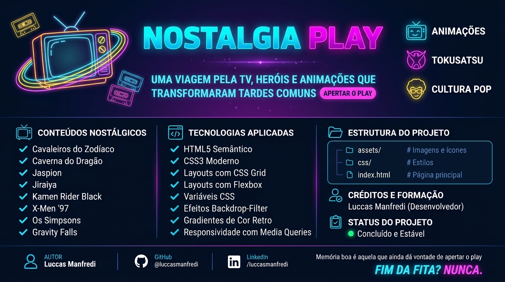

# Nostalgia Play

<p align="center">
  
</p>

Uma viagem pela TV, pelos heróis e pelas animações que transformaram tardes comuns em grandes aventuras.

## Sobre o projeto

O Nostalgia Play é uma página desenvolvida para celebrar desenhos, séries e personagens que marcaram diferentes gerações. O conteúdo reúne clássicos da televisão, heróis tokusatsu e produções que continuam presentes na cultura pop.

## Conteúdos

- **Clássicos:** Cavaleiros do Zodíaco e Caverna do Dragão
- **Heróis:** Jaspion, Jiraiya e Kamen Rider Black
- **Produções atuais:** X-Men '97, Os Simpsons e Gravity Falls

## Tecnologias

- HTML5 semântico
- CSS3
- CSS Grid e Flexbox
- Variáveis CSS, gradientes e efeitos visuais
- Media queries para responsividade

## Como visualizar

Abra o arquivo `index.html` em um navegador. O projeto não precisa de instalação de dependências.

## Estrutura

```text
SOMATIVA2/
├── assets/       # Imagens usadas no projeto
├── index.html    # Página principal
├── style.css     # Estilos
└── README.md     # Apresentação do projeto
```

**Desenvolvido por Luccas Manfredi.**
